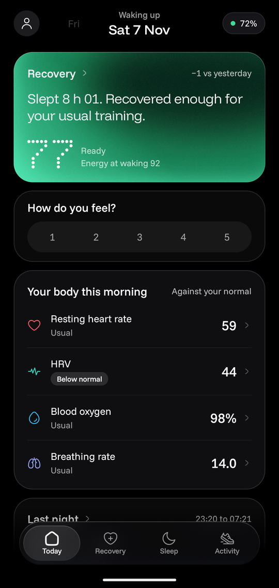
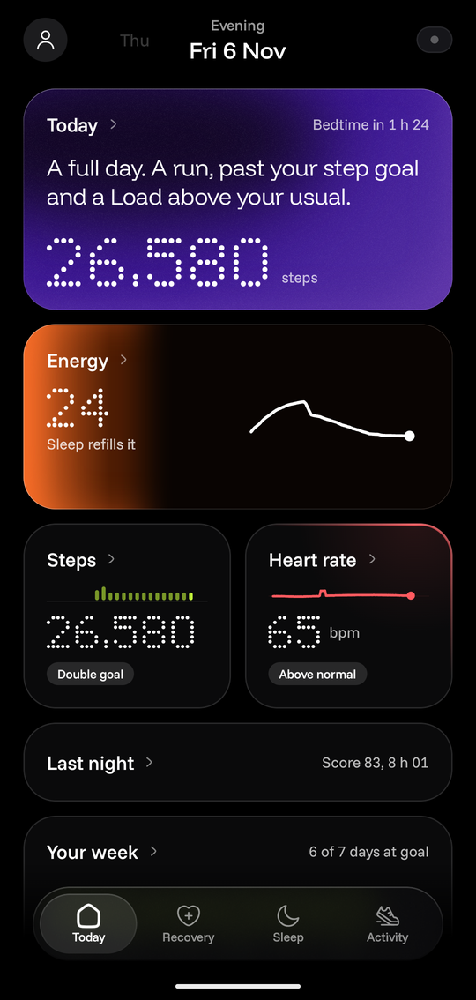
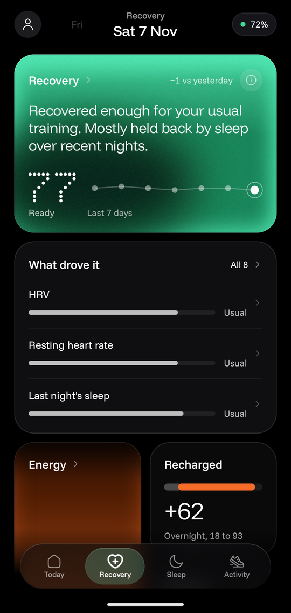
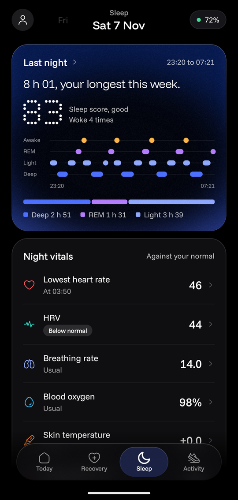
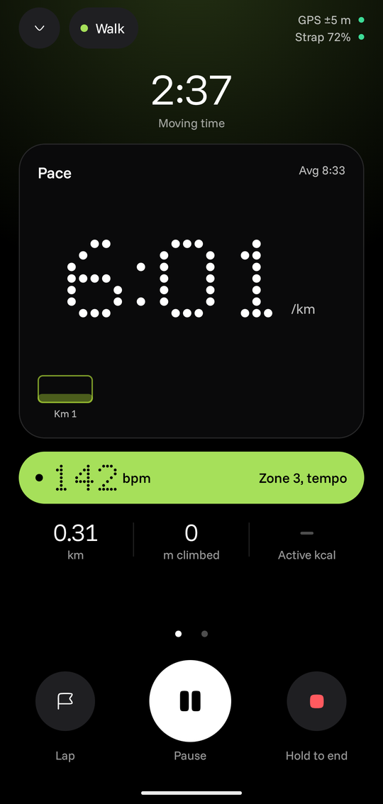

<h1 align="center">
  <picture>
    <source media="(prefers-color-scheme: dark)" srcset="docs/assets/logo-dark.png">
    
  </picture>
</h1>

**Answers, not dashboards.**

Wake up to how recovered you are. Train when your body is ready. Wind down when it's time.

unstrap is a calm Android app for the **Amazfit Helio Strap**. Other apps hand you dashboards to read. unstrap tells you how you slept, how ready you are and what your day needs, in plain words. It replaces the Zepp app, syncs your sleep, heart rate, HRV, SpO₂, stress and workouts, and keeps everything on your phone.

<p align="center">
  
  
  
  
  
</p>

<sub>The first four use the sample data debug builds can generate. The workout is a real walk with a real strap.</sub>

## What it feels like

Most health apps hand you a wall of numbers. unstrap tries to answer one question at a time, in plain words.

- **Today changes with your day.** The app has moments: waking up, midday, your usual workout time, after a workout, evening and night. Each one leads with what matters then. In the morning it's how you slept and how recovered you are. Before your usual run it's whether you're ready for effort. In the evening it's the day in one sentence and when to head to bed.
- **Sentences first, numbers second.** "Recovered enough for your usual training" comes before the 74. Every number is compared with your own normal, not a stranger's.
- **Calm by design.** Dark screens, soft light instead of charts where it can, one colour per metric and no streaks, badges or nagging. Light that rises in a card is a level, like Energy filling up.
- **One tap to the why.** Every card opens a page with the reasoning, the last week, and what moved the number.

## Features

- **Recovery** each morning from HRV, resting heart rate and sleep, with what drove it
- **Energy**, your energy through the day: sleep fills it, effort and stress drain it
- **Sleep** stages, score, regularity, naps and night vitals
- **Activity**: steps, active minutes, Heart points, Load and time to recover
- **Workouts** started on the phone with live heart-rate zones, GPS maps and the strap buzzing you back into your zone
- **Live heart rate**, alarms, health alerts and call or notification buzzes on the strap
- **Find strap**, restart, firmware updates and an off-body reminder
- **Your data is yours**: CSV export and import, and Android Health Connect
- **Foldables and tablets**: two columns, with details opening beside the list

I use it every day with one strap on one Android 16 phone. Other phones and firmware are untested, so reports are welcome. Something not right? **You → Diagnostics → copy** captures a log to attach to an issue.

## Install

Download the APK from the [latest release](https://github.com/sayed0am/unstrap/releases/latest) and open it on your phone (Android 11 or newer). After that, unstrap tells you when a new version is out, shows what changed, and installs it from **You → Updates**. Updates keep your data.

To pair, you need your strap's auth key:

1. **Link the strap in the Zepp app once**, with an email and password account. (Google or Apple sign-in won't work inside unstrap, but you can add an email to your Zepp account.)
2. **Put the strap on its charger** near the phone and force-stop Zepp. Don't unlink the strap in Zepp, because that wipes the key.
3. In unstrap, go to **You → your strap → Sign in with Zepp**, check the strap it finds, and tap **Pair this strap**.

Can't add an email? Get the key on a computer with the [Gadgetbridge guide](https://gadgetbridge.org/basics/pairing/huami-xiaomi-server/#on-a-computer), then tap **Enter it yourself**. Treat the key like a password.

## Privacy

No cloud for your health data, no analytics, no trackers. unstrap only goes online when you ask it to (to sign in with Zepp, to check for firmware, or to load map tiles for a GPS workout), and once a day to ask GitHub whether a new unstrap is out, which you can turn off. [privacy.md](docs/privacy.md) lists every request and every permission, and why.

## Good to know

- **The first pairing still needs Zepp.** The strap only accepts a first pairing Zepp's server has signed. After that, everything is local.
- **Scores won't match Zepp's.** unstrap uses its own model, written out in plain words in [calculations.md](docs/algorithms/calculations.md), with the research behind it in [evidence-review.md](docs/algorithms/evidence-review.md). Recovery needs about a week of nights before it shows a score, and settles over four weeks.
- **Android only.**
- **Not a medical device.** The scores are estimates for personal insight, not medical advice. If you're worried about a reading, talk to a health professional.

## For developers

The strap's protocol was worked out from the Zepp app by static analysis only, written up as specs in [`docs/protocol/`](docs/protocol), and every step checked on a real strap. The code is clean-room and uses no Gadgetbridge (AGPL) code. It was written with AI assistance.

```bash
./gradlew :protocol:test :app:testDebugUnitTest :app:assembleDebug
```

You need JDK 21 and the Android SDK. `protocol/` is pure Kotlin (auth, encryption, sync and parsers) with a simulated strap for tests. `app/` is the Android app in Jetpack Compose. The design system is in [`docs/design/v2/`](docs/design/v2).

To try it without a strap, build a demo copy that installs beside the real app and fill it with three weeks of sample data:

```bash
./gradlew :app:installDebug -PdemoApp
```

```bash
adb shell am start -n org.openstrap.app.demo/org.openstrap.app.MainActivity --ez demo_data true
```

Pushing a `vX.Y.Z` tag publishes a signed release through CI ([`android.yml`](.github/workflows/android.yml)).

## License

[MIT](LICENSE-MIT) or [Apache-2.0](LICENSE-APACHE), your choice. Fonts are under the SIL OFL 1.1 ([licenses/](licenses)). unstrap is not affiliated with Zepp Health or Amazfit.
